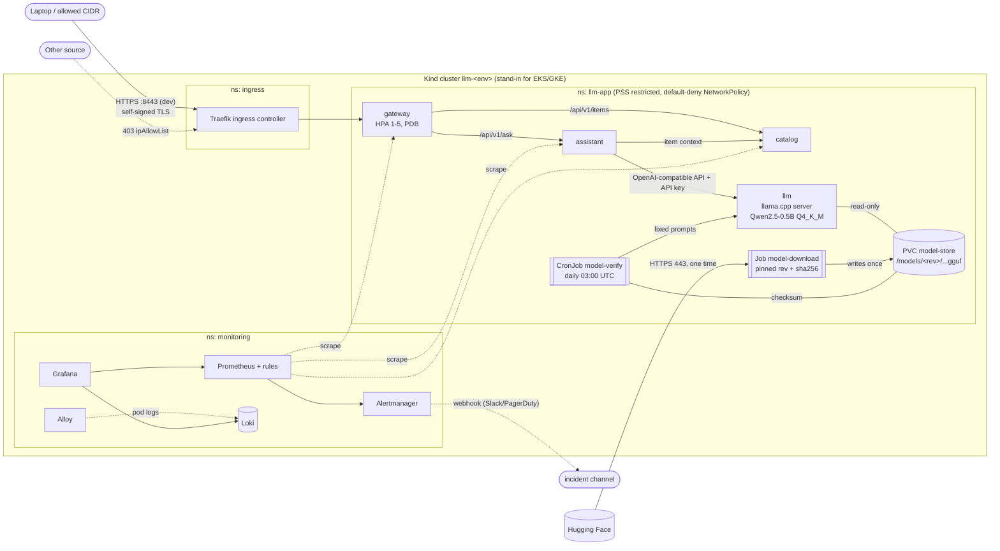

# LLM Stack: a CPU-only LLM application on Kubernetes (Kind)

Three Go microservices and a llama.cpp inference server running **Qwen2.5-0.5B-Instruct** on CPU. They are deployed to a local **Kind** cluster that stands in for a managed cloud cluster, with Terraform, Helm, a CI-agnostic pipeline script, default-deny networking, TLS ingress with an IP allowlist, autoscaling, a scheduled model check, and Prometheus/Grafana/Loki observability.

> Everything runs on a laptop with open-source tools. No cloud account, hosted registry or paid service is used.

| Doc | Contents |
|---|---|
| **[docs/DEMO_GUIDE.md](docs/DEMO_GUIDE.md)** | **Start here: step-by-step demo with make and raw commands, plus talking points** |
| [docs/RUNBOOK.md](docs/RUNBOOK.md) | Setup, deploy, verify (live demo script), rollback, teardown, troubleshooting, alert runbooks |
| [docs/MODEL.md](docs/MODEL.md) | Model source, pinned revision, checksum, license, download/verification flow |
| [docs/SECURITY_AND_OPERATIONS.md](docs/SECURITY_AND_OPERATIONS.md) | Security controls, operational decisions, scaling the LLM, secrets in the cloud |
| [docs/CLOUD_PORTABILITY.md](docs/CLOUD_PORTABILITY.md) | One-page local → AWS/GCP mapping |
| [AI_USAGE.md](AI_USAGE.md) | How AI tools were used and how their output was checked |
| [reports/](reports/) | SBOMs (SPDX), vulnerability scan reports, tool versions |

---

## Architecture



### Components

| Component | Tech | Exposure | Notes |
|---|---|---|---|
| **gateway** | Go (stdlib), distroless | Only workload behind the ingress | `GET /healthz`, `GET /api/v1/items[/{id}]` → catalog, `POST /api/v1/ask` → assistant. HPA on CPU |
| **catalog** | Go, distroless | ClusterIP | `GET /items`, `GET /items/{id}` (404 JSON if unknown); 5 seeded in-memory items |
| **assistant** | Go, distroless | ClusterIP | `POST /answer {"question","item_id?"}` → fetches item, builds prompt, calls LLM, returns `{"answer"}` |
| **llm** | llama.cpp `llama-server` b11223 | ClusterIP | OpenAI-compatible `/v1/chat/completions`, API key from Secret, `/health` for probes, CPU only |
| **model-download** | Job (curl + sha256sum) | egress 443 only | One-time download of the pinned revision into the PVC; fails on checksum mismatch |
| **model-verify** | CronJob, daily | - | Re-checks checksum + runs 3 fixed prompts; alerts on failure |
| Traefik | Helm chart 41.6.1 | hostPort 443 → `127.0.0.1:<port>` | TLS termination, `ipAllowList` middleware |
| kube-prometheus-stack | 91.9.0 | port-forward | Prometheus, Alertmanager, Grafana, kube-state-metrics |
| Loki + Alloy | 7.3.0 / 1.13.0 | - | Central JSON logs from every pod |
| metrics-server | 3.14.0 | - | Feeds the HPA |

### Data flow (one `/api/v1/ask` request)

1. The client sends `https://app.dev.llmstack.local:8443/api/v1/ask` → Docker port mapping → Traefik on the Kind control-plane node.
2. Traefik terminates TLS and checks the source IP against the `ip-allowlist` middleware (403 if not allowed). It then forwards to `gateway:8080`. The NetworkPolicy only admits traffic from the `ingress` namespace.
3. gateway → `assistant:8080/answer`. assistant → `catalog:8080/items/item-1` for context. Then assistant → `llm:8080/v1/chat/completions` with `Authorization: Bearer <key from Secret>`.
4. The answer flows back. Every hop emits JSON logs (→ Alloy → Loki) and Prometheus metrics (`http_requests_total`, `http_request_duration_seconds`).

### Environments

The same Terraform code and the same Helm chart serve every environment. Only variables differ:

| | dev | prod |
|---|---|---|
| Cluster | `llm-dev` (1 control-plane + 1 worker) | `llm-prod` (1 control-plane + 2 workers) |
| Terraform | `envs/dev.tfvars`, state `state/dev.tfstate`, `TF_DATA_DIR=.terraform-dev` | `envs/prod.tfvars`, state `state/prod.tfstate`, `TF_DATA_DIR=.terraform-prod` |
| Helm values | `values-dev.yaml`: 1 replica each, HPA 1-3 | `values-prod.yaml`: 2 replicas each, HPA 2-5 |
| URL | `https://app.dev.llmstack.local:8443` | `https://app.prod.llmstack.local:9443` |
| Secrets / TLS cert | generated per env | generated per env |

Separate clusters per environment (rather than namespaces) mirror the cloud practice of one cluster, and usually one account/project, per environment. They can run side by side because they use different host ports.

**Adding a third environment (e.g. `staging`)** takes three small files and no code changes:

```bash
cp infra/terraform/envs/dev.tfvars infra/terraform/envs/staging.tfvars   # set environment="staging", https_host_port=10443, hostname=app.staging.llmstack.local
echo 'path = "state/staging.tfstate"' > infra/terraform/envs/staging.backend.hcl
cp deploy/helm/llm-app/values-dev.yaml deploy/helm/llm-app/values-staging.yaml  # set environment + ingress.host
make plan ENV=staging && make apply ENV=staging && make deploy ENV=staging
```

---

## Prerequisites

| | Minimum | Used for development |
|---|---|---|
| CPU | 4 cores for Docker | 10 cores (Apple M-series, arm64) |
| Memory | **6 GB for Docker** for one environment with monitoring; ~10 GB for dev + prod side by side | Docker Desktop with 8 GB |
| Disk | ~10 GB free (images + model + node images) | |
| OS | macOS or Linux with Docker | macOS 26, Docker Desktop 28.5 |

Tools (versions used):

```bash
brew install kind terraform helm kubectl trivy syft cosign shellcheck hadolint go
```

| Tool | Version | Tool | Version |
|---|---|---|---|
| Docker | 28.5.1 | Trivy | 0.76.0 |
| kind | 0.33.0 | Syft | 1.55.0 |
| Terraform | 1.13.4 | Go | 1.25 (build image 1.27.1) |
| Helm | 3.19.0 | shellcheck / hadolint | 0.11.0 / 2.15.1 |
| kubectl | 1.34.1 | | |

---

## Quick start

```bash
make check                 # lint, unit tests, build 4 images, trivy gate, SBOMs
make plan  ENV=dev         # terraform plan (shows the cluster, add-ons, namespace, secrets)
make apply ENV=dev         # terraform apply (~5-10 min first time: image pulls)
scripts/ci.sh detect-source-ip dev   # see RUNBOOK §3: records the laptop's source IP for the allowlist
make deploy ENV=dev        # load images into Kind + helm upgrade --atomic
make smoke ENV=dev         # HTTPS end-to-end incl. a real LLM answer
```

Or the whole pipeline in one command (only on `main` or a tag):

```bash
make release ENV=dev       # = check + terraform apply + load + deploy + smoke + cronjob check
```

Try it:

```bash
curl --cacert .kube/llm-dev-ca.pem --resolve app.dev.llmstack.local:8443:127.0.0.1 \
  -H 'Content-Type: application/json' \
  -d '{"question":"Summarize this item","item_id":"item-1"}' \
  https://app.dev.llmstack.local:8443/api/v1/ask
```

The full live-demo sequence (plan/apply, blocked source, HPA, CronJob, alert, bad release + rollback, destroy/recreate) is in [docs/RUNBOOK.md §4](docs/RUNBOOK.md#4-verification--live-demo).

---

## Repository layout

```
services/                Go module: cmd/{gateway,catalog,assistant}, internal/{server,catalog}, Dockerfile
llm/Dockerfile           llama.cpp server, pinned by digest, non-root
deploy/helm/llm-app/     Helm chart (+ values-dev.yaml, values-prod.yaml, Grafana dashboard JSON)
infra/terraform/         root module + modules/{kind-cluster,platform} + envs/<env>.{tfvars,backend.hcl}
scripts/ci.sh            CI/CD entry point (check | release | plan | apply | destroy | deploy | smoke | ...)
scripts/demo/            live-demo helpers (blocked request, HPA load, bad release, alert)
reports/                 sbom/*.spdx.json, scans/*.{txt,json}, tool-versions.txt
docs/                    runbook, model, security & operations, cloud portability
Makefile                 thin wrapper over scripts/ci.sh
```

---

## CI/CD pipeline

`scripts/ci.sh` is plain bash. Any CI system (GitHub Actions, GitLab, Jenkins, a cron on a laptop) just calls it.

| Mode | When | Steps |
|---|---|---|
| `check` | every change / PR | gofmt + go vet, shellcheck, hadolint, terraform fmt + validate, helm lint (dev + prod), **trivy config** on the rendered chart (fails on HIGH/CRITICAL misconfig) → `go test -race` → build 4 images tagged with the git sha → **trivy image** (full report saved; **gate fails on fixable vulnerabilities ≥ `SEVERITY_THRESHOLD`, default CRITICAL**) → **syft** SPDX SBOM per image |
| `release <env>` | `main` branch or a git tag only (refuses otherwise, and refuses a dirty tree) | `check` → `terraform plan -out` + `apply` of that plan → `kind load` images → `helm upgrade --install --atomic --wait` → smoke test through TLS ingress (auto-rollback on failure) → run the CronJob once and assert success |

Gate failure example: `FAIL: vulnerability gate: fixable CRITICAL findings in: llm. Fix (bump base image / dependency) or, with justification, add the CVE to .trivyignore.`

Secrets in logs: the script never enables `set -x`, never reads secret values, and Terraform marks generated secrets `sensitive`. The LLM key reaches pods only through `secretKeyRef`.

---

## Design decisions and trade-offs

**Key decisions**

- **Go with stdlib only (plus the Prometheus client) on distroless/static.** The images are ~21 MB with no shell or package manager, and the vulnerability scan is nearly empty. A fixed CVE gate at CRITICAL is realistic rather than permanently red.
- **llama.cpp + GGUF Q4_K_M** instead of PyTorch/vLLM. It is about 10× smaller and faster to start on CPU, and has a built-in OpenAI-compatible API, API key and health endpoint. The upstream image was wrapped only to force a non-root uid.
- **Traefik** instead of ingress-nginx. ingress-nginx is retired upstream (2026). Traefik's `ipAllowList` middleware gives the IP restriction.
- **Terraform owns the infrastructure; Helm (via the script) owns the app.** App releases and rollbacks (`helm rollback`) don't touch Terraform state or risk infrastructure drift. Terraform still creates everything the app needs: namespace with PSS labels, Secrets, TLS cert.
- **One cluster per environment** with separate state and data dirs, so `dev` and `prod` cannot affect each other.
- **Model on a PVC filled by a Job**, versioned by path (`/models/<revision>/`). Changing the pinned revision downloads alongside the old file, so pods switch only after verification.
- **Readiness-gated rolling updates with `maxUnavailable: 0`.** A bad image stalls the rollout while old pods keep serving. `--atomic` turns a failed release into an automatic rollback.

**Simplifications (time-boxed)**

- No registry, so **images are not signed**. Signing is documented in [SECURITY_AND_OPERATIONS.md](docs/SECURITY_AND_OPERATIONS.md#image-signing), and `cosign` is installed.
- The self-signed TLS key and generated secrets live in the **local Terraform state**. It is git-ignored, but in the cloud it would be an encrypted remote backend plus External Secrets.
- Loki and Prometheus are single-replica on node-local storage, with short retention (72h / 3d).
- The LLM runs as a single replica by default (CPU-bound, ~1.5 GB per replica). No HPA on it (see scaling notes).
- The incident channel is not connected. Alertmanager routes to an `incident-channel` receiver whose webhook URL is injected via `TF_VAR_incident_webhook_url` into a Secret.
- llama.cpp `/metrics` is protected by the API key, so it is not scraped. LLM health is observed through kube-state-metrics and the assistant's latency.

**Known limitations**

- The source IP that Traefik sees for laptop traffic is the Docker Desktop gateway address, not the real client. The allowlist demo therefore contrasts "laptop (allowed)" with "another host on the Docker network (blocked)". In the cloud the LB preserves client IPs.
- The `ingress` namespace runs PSS `privileged` because Kind needs a hostPort. All app pods run `restricted`.
- One `kind` node is one Docker container. HPA scale-up is real, but "more nodes" is simulated.
- CPU inference latency is about 1-5 s per answer with 2 threads. Concurrency is capped by `--parallel 2` per replica.

**With more time**

- Local OCI registry + cosign signing + Kyverno `verifyImages` admission policy.
- An HPA or KEDA for the LLM based on queue depth (llama.cpp `requests_processing`), plus a dedicated, tainted LLM node pool.
- cert-manager with a local CA, NetworkPolicy tests in CI (e.g. `kubectl auth`/`netassert`), `terratest` for the modules.
- An SLO-based burn-rate alert instead of a raw error-ratio threshold, and Alertmanager → a real Slack channel.
- Canary or blue/green rollouts (Argo Rollouts) with automatic analysis on the error-rate metric.

## Third-party components and credits

All are consumed as pinned upstream images or charts. No third-party source is vendored into this repository.

| Component | License |
|---|---|
| Qwen2.5-0.5B-Instruct-GGUF (Alibaba Qwen team) | Apache-2.0 |
| llama.cpp (ggml-org) | MIT |
| Traefik, kube-prometheus-stack, metrics-server, Loki, Alloy Helm charts | Apache-2.0 (Loki/Alloy software: AGPL-3.0 / Apache-2.0, used unmodified) |
| Go Prometheus client | Apache-2.0 |
| distroless (Google), curl image (curl project) | Apache-2.0 / curl license |
